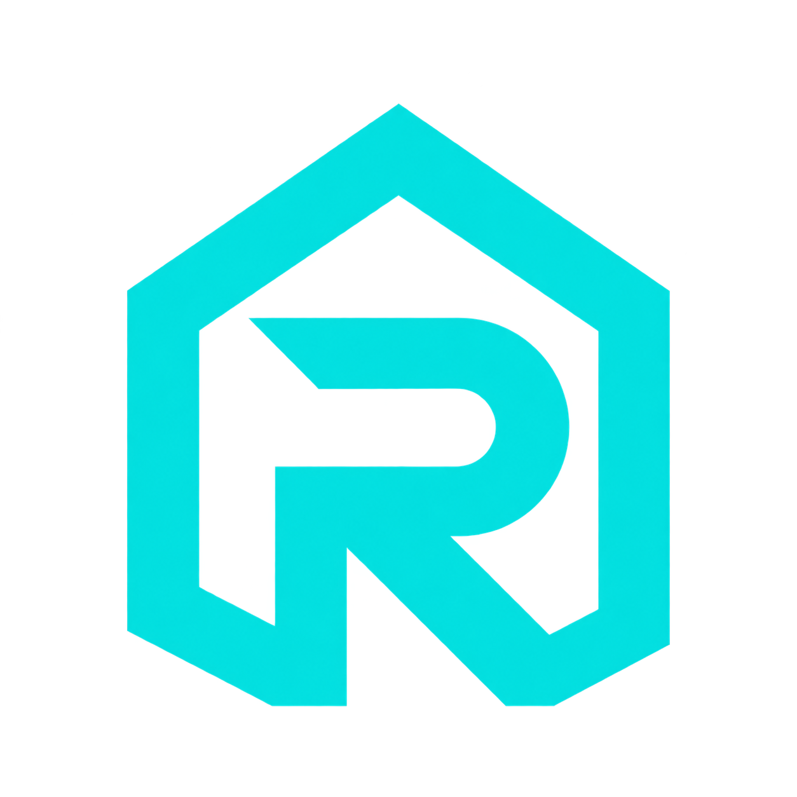

<p align="center">
  <a href="https://docs.roboalarms.com">
    
  </a>
</p>

<h1 align="center">RoboAlarms Documentation</h1>

The source for the [RoboAlarms Documentation Site](https://docs.roboalarms.com): practical guides for users, installers, Home Assistant integrations, the Flasher, and the Panel Manager.

Built with [Astro](https://astro.build) and [Starlight](https://starlight.astro.build). This repository builds independently of the alarm firmware. The current documentation edition and reviewed software versions are documented in [About this edition](src/content/docs/reference/edition.mdx).

## Develop locally

Install Node.js 24 LTS and pnpm 11.25.0, then:

```sh
git clone https://github.com/RoboAlarms/documentation.git
cd documentation
pnpm install --frozen-lockfile
pnpm dev
```

Open the loopback URL printed by Astro, normally `http://127.0.0.1:4321`.

```sh
pnpm validate                  # type checks, production build, links, and images
pnpm preview                   # inspect the production build locally
```

The package manager is pinned in `package.json`; dependencies are recorded in `pnpm-lock.yaml`.

## Repository layout

| Path | Purpose |
| --- | --- |
| `src/content/docs/` | Documentation pages, grouped by guide |
| `src/components/`, `src/styles/` | Shared components and site styling |
| `src/assets/`, `public/` | Brand assets and curated screenshots |
| `*-manifest.json` | Screenshot dimensions, hashes, and provenance |
| `scripts/` | Production link and image verification |
| `Dockerfile`, `docker/` | Production image and static server configuration |
| `.github/workflows/ci.yml` | Build and container smoke checks |

Generated files and local capture sessions are excluded from Git and Docker's build context.

## Run with Docker

```sh
docker build -t roboalarms-docs .
docker run --rm -p 127.0.0.1:8080:8080 roboalarms-docs
```

Open `http://127.0.0.1:8080`. The multi-stage image validates and builds the website, then serves the generated files using an unprivileged Nginx process on port **8080**. No runtime credentials or persistent storage are required.

## Maintenance

External contributions are not being accepted at this time.

See the [maintenance guidelines](docs/maintenance.md) for content conventions and validation, and [UPDATING.md](UPDATING.md) for edition and screenshot maintenance.

## License

Licensed under [Apache-2.0](LICENSE), retaining attribution to the upstream RoboAlarms Panel authors. See [NOTICE](NOTICE) and [licenses/](licenses/) for third-party notices associated with the screenshots.
